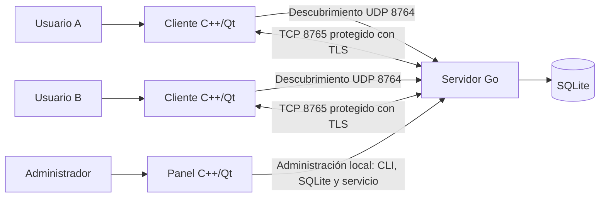
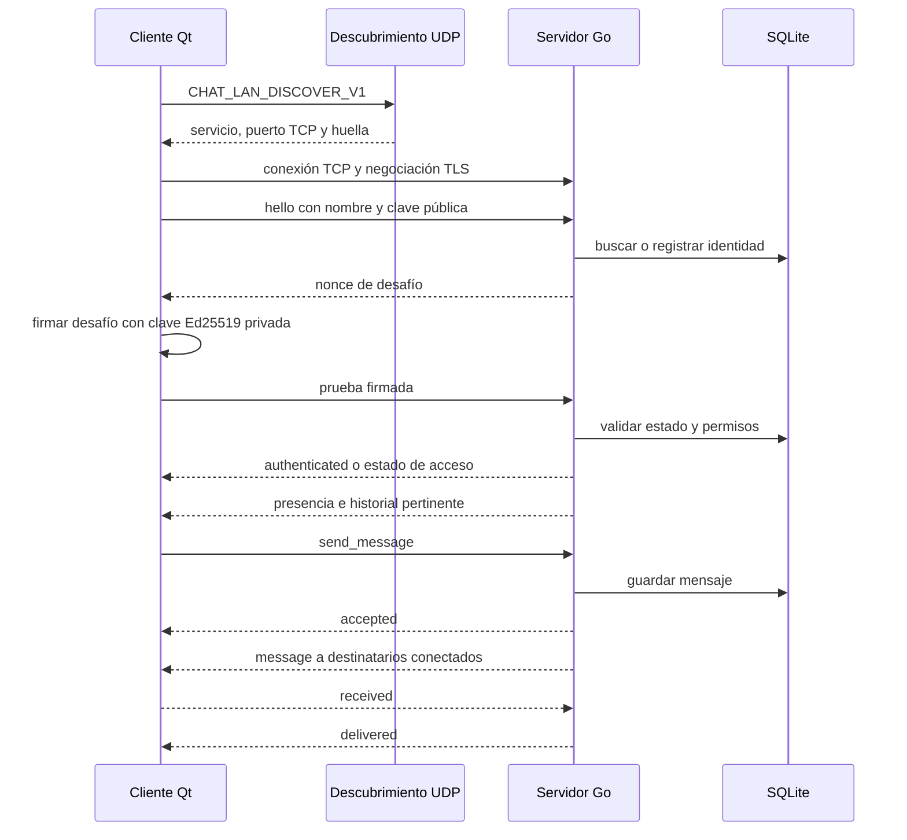

# Arquitectura de CHATLAN

## Propósito y alcance

CHATLAN es una aplicación de mensajería de texto para usuarios de una red local. La entrega integrada tiene tres piezas: servidor Go, cliente de escritorio C++/Qt y panel de administración C++/Qt. El almacenamiento persistente del servidor es SQLite. `chat-lan-cpp` conserva además un servidor C++ alternativo; no es el servidor utilizado por la configuración integrada descrita aquí.

La aplicación maneja conversación general y privada, presencia, historial limitado y aprobación de cuentas. No incluye archivos adjuntos, imágenes, audio, llamadas, entrega a usuarios desconectados ni confirmación de lectura por una persona.

## Contexto del sistema

Los clientes buscan el servidor por UDP o usan una dirección conocida. UDP solo anuncia cómo alcanzarlo; autenticación y mensajes viajan por TCP con TLS. El panel opera el servicio y sus datos en el equipo administrador; no hay una API remota de administración.

## Contenedores y responsabilidades

| Contenedor | Tecnología | Responsabilidad |
| --- | --- | --- |
| Servidor | Go | Descubrimiento, TLS, autenticación, conexiones, presencia, permisos, mensajes y persistencia. |
| Cliente | C++20, Qt Widgets/Network | Perfil local, conexión segura, conversación, estado y recepción de eventos. |
| Panel | C++20, Qt Widgets | Estado del servicio, configuración y acciones sobre cuentas. |
| Base del servidor | SQLite | Claves públicas, estados de cuenta, metadatos y mensajes. |
| Perfil cliente | Archivos locales | Clave privada Ed25519, configuración y certificado público fijado. |

El panel no es necesario para conversar; también existen comandos administrativos en el servidor.

## Recorrido de una conexión

En la primera autenticación se asocia la identidad a su clave pública Ed25519. La clave privada se genera y conserva en el perfil cliente; el servidor verifica firmas con la clave pública. El acceso depende del estado de cuenta y del cupo de cuentas aprobadas. La primera ejecución crea certificado TLS y base si aún no existen.

## Mapa del código

### Servidor Go (`SERVER_JP/`)

| Archivo | Responsabilidad |
| --- | --- |
| `main.go` | Comandos, banderas, configuración y ciclo de vida. |
| `server.go` | Escuchas TCP/UDP, conexiones, autenticación, eventos y presencia. |
| `protocol.go` | JSON con longitud prefijada y lectura de tramas. |
| `tls.go` | Certificado TLS y datos de identidad del servidor. |
| `store.go` | Esquema y operaciones SQLite, cuentas, mensajes y copias. |
| `packaging/` | Paquetes Debian y cliente portátil integrado. |

### Cliente y panel (`chat-lan-cpp/`)

| Ruta | Responsabilidad |
| --- | --- |
| `src/client/main.cpp`, `window.cpp` | Inicio del cliente, ventanas y presentación. |
| `src/client/connection.cpp` | Transporte, TLS, descubrimiento UDP y eventos de red. |
| `src/common/protocol.cpp` | Serialización y encuadre de mensajes. |
| `src/common/crypto.cpp` | Operaciones criptográficas del cliente. |
| `src/common/store.cpp`, `paths.cpp` | Datos locales de perfil y rutas. |
| `src/admin/main.cpp`, `gui.cpp` | Entrada y ventana del panel. |
| `src/server/` | Servidor C++ alternativo. |

## Para qué sirve cada archivo

### Servidor Go (`SERVER_JP/`)

| Archivo | Qué hace y cuándo consultarlo |
| --- | --- |
| `main.go` | Es la entrada del servidor: lee subcomandos y opciones, resuelve configuración, prepara TLS/SQLite, arranca el servicio y despacha órdenes administrativas. Para entender `init`, `server`, `list`, `approve` o `backup`, empieza aquí. |
| `protocol.go` | Define los paquetes JSON, el límite y el encuadre de tramas, Base64, UUID y la carga firmada Ed25519. Es el lugar para estudiar cómo se representan los bytes en la red y cómo se verifica el reto. |
| `server.go` | Implementa la lógica de red: escucha TCP y UDP, filtra IP, crea sesiones TLS, autentica usuarios, distribuye mensajes, actualiza presencia y gestiona recibos. Es el archivo central para seguir una conexión en ejecución. |
| `tls.go` | Crea y carga `server.pem`/`server.key`, protege los permisos locales y configura TLS mínimo 1.2. Consultarlo para el certificado, la huella y la clave del servidor. |
| `store.go` | Define modelos y operaciones SQLite: alta de usuarios, permisos, estados, borrado, recuperación, mensajes, historial y copia de seguridad. Consultarlo para saber qué queda persistido. |
| `server_test.go` | Pruebas automatizadas del protocolo, conversación, administración y configuración del servidor. Describe escenarios que el equipo automatizó. |
| `tests/python_compat.py` | Herramienta de compatibilidad con el cliente Python original; no es necesaria para ejecutar el servidor normal. |
| `go.mod` | Declara la versión de Go y las dependencias del módulo. |
| `go.sum` | Guarda comprobaciones criptográficas de las versiones de dependencias descargadas. |
| `packaging/build-client.sh` | Compila/prepara el cliente portátil Qt y lo vincula al certificado/IP indicados. |
| `packaging/build-server-deb.sh` | Construye el paquete Debian del servidor y los componentes integrados. |
| `packaging/chat-lan-go.service` | Unidad systemd de usuario para ejecutar el servidor Go. |
| `packaging/chat-lan-go-admin.desktop` | Entrada del menú de escritorio para abrir la administración. |

### Cliente y componentes C++/Qt (`chat-lan-cpp/src/`)

| Archivo | Qué hace y cuándo consultarlo |
| --- | --- |
| `client/main.cpp` | Inicia la aplicación Qt y selecciona la ventana de chat o el modo de consulta de clave pública para recuperación. |
| `client/window.h` | Declara la ventana, vistas de conversación, señales y estado visual del cliente. |
| `client/window.cpp` | Construye la interfaz, administra perfiles y conversaciones, renderiza mensajes y manda texto por la conexión. Es la entrada principal para entender lo que ve y hace el usuario. |
| `client/connection.h` | Declara la clase de red, temporizadores, sockets, señales y eventos que consume la ventana. |
| `client/connection.cpp` | Descubre el servidor por UDP, establece TLS, comprueba huella, firma el desafío, codifica/envía paquetes y trata reconexiones. |
| `common/protocol.h` | Declara el codificador/decodificador de tramas y utilidades compartidas del protocolo. |
| `common/protocol.cpp` | Implementa JSON compacto, prefijo de longitud, acumulación de lecturas TCP, validación y bytes de prueba Ed25519. |
| `common/crypto.h` | Declara identidad Ed25519, firma, verificación y operaciones de certificado. |
| `common/crypto.cpp` | Genera/carga claves del perfil, firma pruebas, calcula huellas y crea certificados para el servidor C++ alternativo. |
| `common/paths.h` | Declara funciones comunes para localizar y leer/escribir archivos de datos. |
| `common/paths.cpp` | Resuelve rutas XDG, crea carpetas privadas y accede a JSON y archivos secretos. |
| `common/store.h` | Declara el almacenamiento SQLite compartido por el servidor C++ y sus herramientas. |
| `common/store.cpp` | Implementa tablas, migraciones, cuentas, estados, mensajes, historial y copias para el servidor C++ alternativo. |
| `admin/main.cpp` | Procesa órdenes administrativas de terminal para datos del servidor C++. |
| `admin/gui.cpp` | Construye el panel gráfico y conecta sus controles con el servicio Go o el servidor C++, según el modo. |
| `server/main.cpp` | Interpreta opciones y ejecuta el servidor C++ alternativo. |
| `server/server.h` | Declara el servidor C++, sus peers, sockets y acciones de red. |
| `server/server.cpp` | Implementa escucha, descubrimiento, autenticación, distribución de mensajes y presencia del servidor C++ alternativo. |

### Construcción y recursos C++

| Archivo o carpeta | Para qué sirve |
| --- | --- |
| `chat-lan-cpp/CMakeLists.txt` | Describe targets, dependencias Qt/OpenSSL/SQLite y pruebas para compilar el proyecto C++. |
| `chat-lan-cpp/scripts/build.sh` | Configura y compila los ejecutables C++ en `build/`. |
| `chat-lan-cpp/scripts/run.sh` | Ejecuta desde el árbol de compilación y prepara variables de entorno de Qt. |
| `chat-lan-cpp/packaging/` | Scripts y recursos para generar paquetes Debian o carpetas portátiles del cliente. |
| `chat-lan-cpp/tests/test_chat.cpp` | Prueba funciones centrales de protocolo, cifrado, SQLite y comunicación. |
| `chat-lan-cpp/tests/test_ui.cpp` | Comprueba comportamientos seleccionados de la ventana del cliente. |
| `chat-lan-cpp/tests/test_admin_ui.cpp` | Comprueba comportamientos seleccionados del panel de administración. |
| `chat-lan-cpp/assets/` | Iconos, imágenes y recursos visuales incluidos en la interfaz. |

## Recorrido de lectura por el servidor Go

Para explicar el servidor en una exposición, sigue esta secuencia:

1. `main.go`: cuenta qué comando se ejecuta y qué archivos necesita.
2. `tls.go`: explica cómo el servidor obtiene su certificado y clave.
3. `protocol.go`: muestra cómo se forma una trama y cómo el cliente prueba su identidad.
4. `server.go`: sigue el camino de UDP, TLS, `hello`, `challenge`, `proof`, `authenticated` y `send_message`.
5. `store.go`: localiza en qué momento se guardan cuentas, estados y mensajes.
6. `server_test.go`: identifica qué escenarios se verifican automáticamente.

Los comentarios del código se colocan sobre las funciones y los pasos lógicos con nombres de dominio; los detalles de cada operación están en esta tabla y en la referencia de [protocolo](protocolo.md). Las llaves, imports y asignaciones simples se entienden por su sintaxis y no reciben comentarios repetidos.

## Límites de confianza

TLS protege el canal y la comprobación del certificado ayuda a reconocer el servidor configurado. Ed25519 demuestra control de la clave privada asociada a una cuenta. Esto no es cifrado de extremo a extremo: el servidor puede leer y guarda el texto en SQLite.

La base, el certificado y la clave del servidor pertenecen al equipo servidor. Cada perfil debe proteger `identity.key`. Si se regenera `server.pem`, hay que actualizar la confianza en los clientes; nunca se distribuye `server.key`.

## Límites operativos

- Puertos predeterminados: TCP 8765 y UDP 8764.
- Hasta diez cuentas aprobadas, treinta conexiones y 200 mensajes pertinentes de historial.
- Los mensajes privados requieren que el destinatario esté conectado; no hay cola offline.
- Servidor Go y servidor C++ alternativo compiten por los mismos puertos predeterminados.
