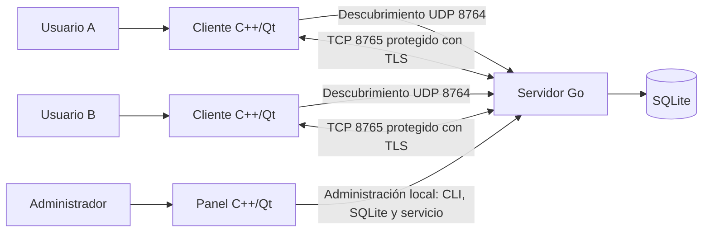
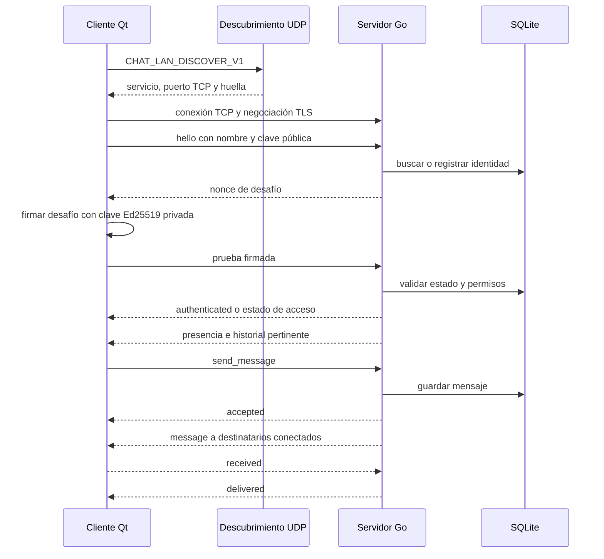

# Arquitectura de CHATLAN

## Propósito y alcance

CHATLAN es una aplicación de mensajería de texto para usuarios de una red local. La entrega integrada tiene tres piezas: servidor Go, cliente de escritorio C++/Qt y panel de administración C++/Qt. El almacenamiento persistente del servidor es SQLite. `chat-lan-cpp` conserva además un servidor C++ alternativo; no es el servidor utilizado por la configuración integrada descrita aquí.

La aplicación maneja conversación general y privada, presencia, historial limitado y aprobación de cuentas. No incluye archivos adjuntos, imágenes, audio, llamadas, entrega a usuarios desconectados ni confirmación de lectura por una persona.

## Contexto del sistema

Los clientes buscan el servidor por UDP o usan una dirección conocida. UDP solo anuncia cómo alcanzarlo; autenticación y mensajes viajan por TCP con TLS. El panel opera el servicio y sus datos en el equipo administrador; no hay una API remota de administración.

## Contenedores y responsabilidades

| Contenedor | Tecnología | Responsabilidad |
| --- | --- | --- |
| Servidor | Go | Descubrimiento, TLS, autenticación, conexiones, presencia, permisos, mensajes y persistencia. |
| Cliente | C++20, Qt Widgets/Network | Perfil local, conexión segura, conversación, estado y recepción de eventos. |
| Panel | C++20, Qt Widgets | Estado del servicio, configuración y acciones sobre cuentas. |
| Base del servidor | SQLite | Claves públicas, estados de cuenta, metadatos y mensajes. |
| Perfil cliente | Archivos locales | Clave privada Ed25519, configuración y certificado público fijado. |

El panel no es necesario para conversar; también existen comandos administrativos en el servidor.

## Recorrido de una conexión

En la primera autenticación se asocia la identidad a su clave pública Ed25519. La clave privada se genera y conserva en el perfil cliente; el servidor verifica firmas con la clave pública. El acceso depende del estado de cuenta y del cupo de cuentas aprobadas. La primera ejecución crea certificado TLS y base si aún no existen.

## Mapa del código

### Servidor Go (`SERVER_JP/`)

| Archivo | Responsabilidad |
| --- | --- |
| `main.go` | Comandos, banderas, configuración y ciclo de vida. |
| `server.go` | Escuchas TCP/UDP, conexiones, autenticación, eventos y presencia. |
| `protocol.go` | JSON con longitud prefijada y lectura de tramas. |
| `tls.go` | Certificado TLS y datos de identidad del servidor. |
| `store.go` | Esquema y operaciones SQLite, cuentas, mensajes y copias. |
| `packaging/` | Paquetes Debian y cliente portátil integrado. |

### Cliente y panel (`chat-lan-cpp/`)

| Ruta | Responsabilidad |
| --- | --- |
| `src/client/main.cpp`, `window.cpp` | Inicio del cliente, ventanas y presentación. |
| `src/client/connection.cpp` | Transporte, TLS, descubrimiento UDP y eventos de red. |
| `src/common/protocol.cpp` | Serialización y encuadre de mensajes. |
| `src/common/crypto.cpp` | Operaciones criptográficas del cliente. |
| `src/common/store.cpp`, `paths.cpp` | Datos locales de perfil y rutas. |
| `src/admin/main.cpp`, `gui.cpp` | Entrada y ventana del panel. |
| `src/server/` | Servidor C++ alternativo. |

## Límites de confianza

TLS protege el canal y la comprobación del certificado ayuda a reconocer el servidor configurado. Ed25519 demuestra control de la clave privada asociada a una cuenta. Esto no es cifrado de extremo a extremo: el servidor puede leer y guarda el texto en SQLite.

La base, el certificado y la clave del servidor pertenecen al equipo servidor. Cada perfil debe proteger `identity.key`. Si se regenera `server.pem`, hay que actualizar la confianza en los clientes; nunca se distribuye `server.key`.

## Límites operativos

- Puertos predeterminados: TCP 8765 y UDP 8764.
- Hasta diez cuentas aprobadas, treinta conexiones y 200 mensajes pertinentes de historial.
- Los mensajes privados requieren que el destinatario esté conectado; no hay cola offline.
- Servidor Go y servidor C++ alternativo compiten por los mismos puertos predeterminados.
